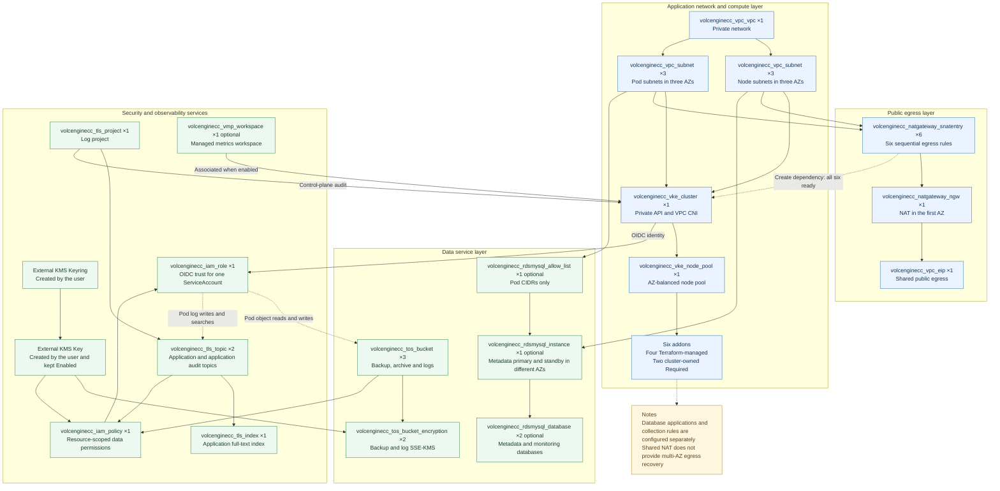

# Enterprise distributed database automation

Use Terraform to deploy infrastructure for distributed databases on Volcengine: VKE across three availability zones, private networking, shared public egress, backup/archive/log storage, Pod access identities and TLS logs, with optional RDS metadata databases and VMP monitoring. Users create and independently manage the KMS Keyring/Key, and deploy database software and backup/restore workflows separately.

## 1. Business Background

Enterprise databases need stable networking and compute, recoverable backups and traceable logs. Maintaining these resources manually introduces several common problems:

- **Missing resource associations**: Subnet egress, bucket encryption, database allowlists and monitoring associations require separate configuration. Omissions can block application access.
- **Shared workload credentials**: Using deployment credentials in database Pods expands data access permissions and increases credential maintenance costs.
- **Difficult change and cleanup checks**: Resources across AZs and service-derived resources need coordinated management to prevent incomplete updates and residual resources.

This project uses Terraform to manage dependencies and grants Pods a data access role restricted to one ServiceAccount, with deployment, verification and cleanup procedures.

## 2. Solution Overview

Nodes and Pods each use private subnets in three AZs. One NAT gateway and one EIP provide egress for all six subnets. The NAT resides in the first node subnet; this shared egress has an AZ failure risk. A single node pool uses `ZoneBalance` with at least three initial nodes. This policy does not guarantee healthy nodes in every AZ at all times: verify placement after deployment and configure database topology spreading and replica anti-affinity separately.

Backup and log buckets use STANDARD storage, multiple AZs and mandatory SSE-KMS. The archive bucket uses ARCHIVE storage in one AZ; reads may require restoration and incur restoration charges. A VKE OIDC role trusts one designated ServiceAccount in one namespace. TOS access is limited to three buckets and TLS access to two topics. KMS `GenerateDataKey` and `Decrypt` use account-wide `Resource="*"` by default; setting `kms_use_account_wide_resource=false` restricts them to the supplied Key TRN.



Solid arrows show resource references; dashed arrows show the labeled data access, creation dependencies or notes. VKE manages derived ECS nodes, disks, interfaces, security groups, CNI components, the IRSA identity provider and control-plane audit topics. Verify their cleanup with the owning cluster or node pool.

## 3. IaC Design

The project uses `volcengine/volcenginecc = 0.0.74` and six local modules. Two `local-exec` scripts reconcile Required addons during creation and remove derived `vke-audit-*` topics from the dedicated TLS project after cluster deletion. The scripts prepare Python and the SDK automatically and inherit the runner's cloud credentials.

### 3.1 Resource Inventory

| Terraform Resource | Purpose | Count |
| --- | --- | ---: |
| `volcenginecc_vpc_vpc` | Private VPC | 1 |
| `volcenginecc_vpc_subnet` | Three node and three Pod subnets | 6 |
| `volcenginecc_natgateway_ngw` | Public NAT | 1 |
| `volcenginecc_vpc_eip` | Egress address bound to NAT | 1 |
| `volcenginecc_natgateway_snatentry` | One SNAT rule per subnet | 6 |
| `volcenginecc_iam_policy` | TOS/TLS/KMS data permissions | 1 |
| `volcenginecc_iam_role` | OIDC workload role | 1 |
| `volcenginecc_tos_bucket` | Backup, archive and log buckets | 3 |
| `volcenginecc_tos_bucket_encryption` | Backup/log SSE-KMS | 2 |
| `volcenginecc_tls_project` | TLS project | 1 |
| `volcenginecc_tls_topic` | Application and application audit topics | 2 |
| `volcenginecc_tls_index` | Application full-text index | 1 |
| `volcenginecc_vke_cluster` | VPC CNI, private API, IRSA, control-plane audit | 1 |
| `volcenginecc_vke_node_pool` | On-demand nodes and scaling bounds | 1 |
| `volcenginecc_vke_addon` | Terraform-managed prometheus-agent, log-collector, node-problem-detector and csi-ebs | 4 |
| `terraform_data` | Required-addon creation reconciliation plus derived VKE audit-topic destroy cleanup | 2 |
| `volcenginecc_vmp_workspace` | Managed metrics workspace associated with VKE | 0/1 |
| `volcenginecc_rdsmysql_allow_list` | Pod allowlist bound to the instance | 0/1 |
| `volcenginecc_rdsmysql_instance` | Primary/standby in two different AZs | 0/1 |
| `volcenginecc_rdsmysql_database` | Metadata and monitoring databases | 0/2 |

The base configuration manages **34** objects: 32 cloud resource declarations and two `terraform_data` helpers. RDS adds four objects and VMP adds one, for **39** with both enabled. The two Required-addon data sources, external KMS Keyring/Key and VKE service-derived resources are excluded from these counts. Resource declaration counts do not equal separately billed items.

### 3.2 Project Structure

```text
.
├── modules/
│   ├── network/                     # Private network and sequential public egress
│   │   ├── main.tf
│   │   ├── variables.tf
│   │   ├── outputs.tf
│   │   └── versions.tf
│   ├── security/                    # External key references and workload identity
│   │   ├── main.tf
│   │   ├── variables.tf
│   │   ├── outputs.tf
│   │   └── versions.tf
│   ├── storage/                     # Three buckets and two encryption configurations
│   │   ├── main.tf
│   │   ├── variables.tf
│   │   ├── outputs.tf
│   │   └── versions.tf
│   ├── observability/               # Logs and optional metrics workspace
│   │   ├── main.tf
│   │   ├── variables.tf
│   │   ├── outputs.tf
│   │   └── versions.tf
│   ├── metadata/                    # Optional primary/standby database and allowlist
│   │   ├── main.tf
│   │   ├── variables.tf
│   │   ├── outputs.tf
│   │   └── versions.tf
│   └── vke/                         # Cluster, node pool and addons
│       ├── main.tf
│       ├── variables.tf
│       ├── outputs.tf
│       └── versions.tf
├── examples/
│   └── addon-versions.json.example  # Addon version configuration reference
├── scripts/
│   ├── cloud_api.py                 # Signed API helpers
│   ├── delete_vke_audit_topics.py    # Derived audit-topic cleanup
│   ├── preflight.py                 # Regional configuration preflight
│   ├── preflight_kms.py             # External key preflight
│   ├── preflight_runtime.py         # Lifecycle runtime checks
│   ├── reconcile_required_addons.py # Required-addon reconciliation
│   ├── requirements.txt            # Lifecycle SDK version
│   └── 运行生命周期.sh             # Automatic lifecycle runtime setup
├── .gitignore
├── main.tf
├── variables.tf
├── outputs.tf
├── providers.tf
├── versions.tf
├── terraform.tfvars                # Replace with your own inputs before use
├── README.md
└── README.zh-CN.md
```

Every module contains `main.tf`, `variables.tf`, `outputs.tf` and `versions.tf`. Only the root configures the provider.

### 3.3 Key Code Examples

The storage module receives the external KMS Key TRN to configure SSE-KMS for backup and log buckets. This excerpt comes from the root `main.tf`:

```hcl
module "storage" {
  source        = "./modules/storage"
  name_prefix   = var.name_prefix
  project_name  = var.project_name
  bucket_suffix = var.bucket_suffix
  kms_key_trn   = module.security.kms_key_trn
  tags          = local.tags
}
```

Key dependencies include all six SNAT rules completing before VKE creation, a ready node pool before Required-addon reconciliation and other addon installation, and RDS binding a Pod-CIDR-only allowlist through `allow_list_ids`. Independently verify encryption and resource associations after deployment.

The pool uses `ignore_changes = [auto_scaling.desired_replicas]`: only the live desired count is owned by the autoscaler; Terraform still owns min/max. Changing `node_scaling.desired` does not resize an existing pool. To change live capacity, adjust min/max or perform a separate runtime scaling operation and verify convergence.

## 4. Usage

This project supports cloud deployment through InfraManager or local deployment using the downloaded template. Cloud deployment is recommended: you do not need to prepare a Terraform runtime, and you can create and manage resources by entering parameters in the platform.

### 4.1 Cloud Deployment

InfraManager is Volcengine's managed Terraform workspace. For more information, see the [InfraManager product introduction](https://docs.volcengine.com/docs/infrastructure-management/product-introduction?lang=zh).

#### 4.1.1 Prepare Permissions

The deployment identity needs create, query, update and delete permissions for the resources in Section 3.1, plus tag management, EIP association, SNAT modification, bucket encryption configuration, IAM policy attachment, VKE IRSA/OIDC management and RDS allowlist association. The two addon data sources require VKE addon read permissions.

Lifecycle scripts also need VKE `ListClusters`, `ListSupportedAddons`, `ListAddons` and `CreateAddon`, plus `DescribeTopics` and `DeleteTopic` on this stack's dedicated TLS project. The workload TOS/TLS/KMS data policy does not replace the deployment policy.

Follow VKE console guidance to prepare `VKEObservabilityRole`, `VKECsiRole` and the required service-linked roles, and authorize TOS SSE-KMS service access. The template does not create or delete these shared roles. See Section 4.2.1 for services, quotas, external keys and login credentials.

The platform runner must support `local-exec`, and the package must include the root module, six child modules and the complete `scripts/` directory. Lifecycle scripts inherit the deployment identity's `VOLCENGINE_ACCESS_KEY` and `VOLCENGINE_SECRET_KEY`; temporary identities also require `VOLCENGINE_SESSION_TOKEN`. No additional Service AK/SK is required. See Section 4.2.1 for runner network and tool requirements.

#### 4.1.2 Select the Template

Open the [InfraManager console](https://console.volcengine.com/iac), go to **Template Management > Public Templates**, and search for “企业级分布式数据库自动化管理”.

#### 4.1.3 Create a Stack

Select the template and click **Create Stack**. Enter the stack information and template parameters for your requirements. Create and review the execution plan, then click **Deploy** after confirming the changes are as expected.

See Sections 4.2.1 and 4.2.2 for inputs and scenarios. Replace the example account, key, image, name prefix and bucket suffix. Use platform secret variables for passwords and prevent same-name `tfvars` assignments from overriding injection. Keep the default parallelism of `10`; confirm 34 managed objects for the base configuration and optional increments as described in Section 3.1.

#### 4.1.4 Verify the Deployment

Confirm that the deployment status is successful on the stack details page, then review the template outputs:

| Output | Purpose |
| --- | --- |
| `network` | Locate the VPC, three node subnets, three Pod subnets, NAT, EIP address and six SNAT rules |
| `storage` | Three bucket names, external KMS Key ID/TRN and keyring name |
| `cluster` | Cluster, node pool, six addons, OIDC and private API addresses |
| `observability` | TLS project and two topics; `workspace_id=null` when VMP is disabled |
| `metadata` | `null` when disabled; RDS instance, allowlist, private addresses and two database names when enabled |
| `workload_access` | Region, namespace, ServiceAccount, role, key and log topic for Pod access |
| `expected_managed_resource_count` | Number of managed objects calculated from feature switches |

None of the seven outputs is marked sensitive, and they contain no passwords, AK/SK, Tokens or kubeconfig. They still identify resources and should be shared according to project permissions. Check the objects in Section 3.1 in the resource tab: the base configuration has 32 cloud resources and two helpers. Check service-derived resources separately in their service consoles.

Use stack outputs to locate resources and perform the basic checks in Section 4.2.4 through the VKE, TOS, KMS and TLS consoles. If RDS or VMP is enabled, inspect the corresponding instance or workspace and its associations. No local Terraform State download is needed.

### 4.2 Local Deployment

You can also download and run the template locally by following the steps below.

#### 4.2.1 Prepare the Environment

**Base environment**:

Use Linux, Terraform `>= 1.5.7, < 2.0.0` and the pinned provider `volcengine/volcenginecc = 0.0.74`; this lower bound meets both root and child module requirements. Retain `.terraform.lock.hcl` generated during initialization.

The runner needs `/bin/sh`, `curl` or `wget`, `unzip` and a SHA-256 tool, with access to Terraform Registry, Volcengine APIs, GitHub and Python download sources. `scripts/运行生命周期.sh` automatically prepares Python 3.12 and the dependencies in `scripts/requirements.txt`; no manual SDK installation is required.

For basic checks with `kubectl`, connect the terminal to the private Kubernetes API through VPN, peering or a bastion and obtain kubeconfig from the VKE console.

For a first local deployment, create a separate execution copy of the downloaded complete template and keep State and runtime data there:

```bash
umask 077
mkdir -p /tmp/数据库运行
cp -R modules scripts examples ./*.tf terraform.tfvars /tmp/数据库运行/
cd /tmp/数据库运行
```

Edit `terraform.tfvars` in that copy, replace existing example identifiers with your own inputs, and remove same-name assignments for `node_password` and `metadata_admin_password` before using the environment variables below. Updates and destruction of an existing stack must continue with its original State/backend and complete project. For production collaboration, configure a remote backend with encryption, locking and version management before the first deployment.

**Services and quotas**:

- Enable the services corresponding to Section 3.1, prepare an existing enterprise project and the permissions in Section 4.1.1. Check types, images, Kubernetes/addon versions and quotas in three AZs; reserve compute and network capacity for `node_scaling.max`.
- Create an external KMS keyring and symmetric Key in the same region, with status `Enable` and usage `ENCRYPT_DECRYPT`. Supply matching ID/TRN and keep the Key available while buckets and backups use it.
- Prepare an existing ECS SSH key pair for key login or a root password for password login. Check specifications, quotas and costs for optional RDS/VMP separately.

**Credential injection** (environment variables are recommended; do not store credentials in code or `tfvars`):

```bash
export VOLCENGINE_ACCESS_KEY="your_access_key"
export VOLCENGINE_SECRET_KEY="your_secret_key"
export VOLCENGINE_REGION="cn-beijing"
```

Temporary identities also require `VOLCENGINE_SESSION_TOKEN`. `providers.tf` explicitly uses `var.region`; `VOLCENGINE_REGION` does not override it. Keep both consistent.

**Sensitive business variables**: `node_password` is the node root password in password login mode; `metadata_admin_password` is the privileged account password when RDS is enabled. Both are marked sensitive. Inject them through environment variables instead of storing them in `terraform.tfvars`:

```bash
export TF_VAR_node_password="<node_password>"
# Set only when enabling RDS.
export TF_VAR_metadata_admin_password="<metadata_admin_password>"
```

The current example file already assigns a node password. Remove the same-name assignment in the execution copy before using environment variables. Same-name `tfvars` variables, including `null`, override `TF_VAR_*`, and objects are not merged automatically. Keep the same passwords for subsequent operations and protect State and plan files containing them.

Node passwords require 8–30 characters and RDS passwords 8–32, with at least three character classes and the allowed-character rules in `modules/vke/main.tf` and `variables.tf`. Supply the raw node password; the module applies Base64 encoding.

**Key parameters**:

The table covers every root input in `variables.tf`. Defaults come from variable definitions; inputs without defaults are required. The current `terraform.tfvars` example uses Beijing, password login, `ecs.g3i.xlarge` and Kubernetes `1.32`, with RDS, VMP and deletion protection disabled. It explicitly sets `metadata_zones` to Beijing a/b. Its account, key, image, bucket suffix and names are not general defaults.

| Parameter | Type; variable default | Description |
| --- | --- | --- |
| `region` / `project_name` | string; `cn-beijing` / `default` | Target region and existing enterprise project |
| `name_prefix` / `bucket_suffix` | string; `enterprise-db` / required | 3–20 lowercase letters, digits or hyphens; prefix starts with a letter; globally unique bucket suffix starts and ends with a letter or digit |
| `account_id` | string; required | Numeric deployment account ID |
| `kms_key_id` / `kms_key_trn` | string; required | External Key UUID/TRN in the same region/account, identifying the same key |
| `kms_use_account_wide_resource` | bool; `true` | Account-wide KMS permissions; false restricts access to the supplied Key TRN |
| `tags` | map(string); `{}` | Additional tags merged with `ManagedBy` and `Solution` |
| `vpc_cidr` / `service_cidr` | string; `10.80.0.0/16` / `172.30.0.0/16` | Canonical IPv4 ranges; VPC is private and the two ranges do not overlap |
| `topology` | list(object); Beijing a/b/d AZs | Each item contains `zone`, `node_cidr` and `pod_cidr`; six subnets must be inside the VPC without overlap; see `variables.tf` for complete defaults |
| `nat_spec` / `eip_bandwidth` | string / number; `Small` / `20` | NAT specification; egress Mbps, integer 1–200 |
| `image_id` | string; required | Regional image starting with `image-`, compatible with the selected VKE version |
| `node_login_mode` | string; `password` | Node login; alternative `key_pair`, without changing kubeconfig |
| `ssh_key_pair_name` / `node_password` | string; `null` / `null` | Supply only the credential for the login mode; the password is sensitive and must be supplied raw |
| `instance_types` / `kubernetes_version` | list(string) / string; `["ecs.g3i.xlarge"]` / `1.32` | Types must be available in three AZs; IRSA requires at least `1.24` |
| `addon_versions` | object; required | Regionally compatible versions for six addons |
| `required_addons_reconcile_nonce` / `required_addons_timeout` | string / number; `v1` / `1200` | Changing nonce reruns Required-addon reconciliation; wait in seconds, integer 300–3600 |
| `node_scaling` | object; `{min=3, desired=3, max=9}` | Integers, `3 <= min <= desired <= max <= 2000`; desired is only used at creation |
| `delete_protection_enabled` | bool; `false` | VKE/RDS deletion protection; update to false before destruction |
| `workload_namespace` / `workload_service_account` | string; `database` / `data-access` | Namespace and ServiceAccount trusted by IAM |
| `tls_log_ttl_days` | number; `30` | Application-topic retention in days, integer 1–3650; control-plane audit is fixed at 30 days |
| `enable_vmp` / `vmp_instance_type_id` | bool / string; `false` / `""` | Supply an available specification ID when enabling VMP |
| `enable_metadata_db` | bool; `false` | Create one primary/standby RDS instance, an allowlist and two databases |
| `metadata_node_spec` / `metadata_zones` | string / list(string); `rds.mysql.c.s.1c2g` / `null` | Defaults to the first two topology AZs; two distinct AZs must support the type, with the primary AZ matching the first node subnet |
| `metadata_storage_type` / `metadata_storage_gb` | string / number; `CloudESSD_PL0` / `100` | RDS storage type and capacity in GB |
| `metadata_admin_name` / `metadata_admin_password` | string; `db_admin` / `null` | Supply the administrator password when enabling RDS; the password is sensitive |

`addon_versions` must contain `core_dns`, `metrics_server`, `prometheus_agent`, `log_collector`, `node_problem_detector` and `csi_ebs`. Use `terraform.tfvars` and `examples/addon-versions.json.example` as references, and recheck compatible releases when changing regions or Kubernetes versions.

#### 4.2.2 Scenario-based Deployment Examples

Initialize and validate in the separate execution directory:

```bash
terraform init
terraform fmt -check -recursive
terraform validate
```

**Example 1: Base infrastructure**. Supply the required inputs, inject the node password through `TF_VAR_node_password`, and keep this configuration:

```hcl
node_login_mode           = "password"
ssh_key_pair_name         = null
enable_metadata_db        = false
enable_vmp                = false
delete_protection_enabled = false
```

```bash
terraform plan -input=false -out=/tmp/数据库基础.tfplan
# Review resources, costs and replacement actions before applying.
terraform apply -input=false /tmp/数据库基础.tfplan
```

Expect 34 managed objects covering private VKE across three AZs, shared egress, storage, identity and logs. Users deploy database software separately.

**Example 2: Optional services**. Adjust the base configuration as shown below, then review and deploy with the same Plan/Apply commands:

| Scenario | Input changes | Expected result |
| --- | --- | --- |
| Metadata database | `enable_metadata_db=true`; check `metadata_*` inputs and inject `TF_VAR_metadata_admin_password` | Add one MySQL 8.0 primary/standby instance, a Pod allowlist and two databases, for 38 objects |
| Monitoring | `enable_vmp=true`; supply an available `vmp_instance_type_id` | Add a VMP workspace associated with VKE, for 35 objects |
| Both enabled | Supply both sets of inputs above | 39 objects |

For node key-pair login, set `node_login_mode="key_pair"` and `ssh_key_pair_name="<ssh_key_pair_name>"`, remove the node password assignment, and run `unset TF_VAR_node_password` so the password defaults to `null`. This does not add objects. Check login updates for existing nodes against the [VKE node-pool documentation](https://docs.volcengine.com/docs/vke/createnodepool?lang=zh).

Disabling RDS/VMP deletes the corresponding resources rather than pausing the services. Changes to topology, names or images may trigger replacements; inspect the plan. Changing `node_scaling.desired` alone does not resize an existing pool.

#### 4.2.3 Expected Deployment Results

The base configuration should create a VKE cluster with a private API, three initial on-demand nodes and six addons. The node pool spans three node subnets using `ZoneBalance`; each node has an 80 GB `ESSD_PL0` system disk. Six node/Pod subnets share one NAT/EIP, with associations established for three buckets, two SSE-KMS configurations, an IRSA data role and TLS resources.

The managed object count is `34 + (enable_metadata_db ? 4 : 0) + (enable_vmp ? 1 : 0)`. The two Required addons are read-only queries; external KMS and VKE-derived resources are excluded. Declaration counts do not equal separately billed items.

View outputs with:

```bash
terraform output
```

See the output table in Section 4.1.4 for all seven outputs. Use `metadata` and `observability.workspace_id` to identify enabled optional resources. Outputs only locate resources; verify actual status and application access below.

#### 4.2.4 Post-deployment Verification

Use `terraform output` or stack outputs to locate resources and check them in the corresponding consoles:

| Check | Basic expectation |
| --- | --- |
| VPC/NAT | All six subnets have SNAT rules using the same NAT and EIP |
| VKE | Cluster, node pool and six addons Running; nodes Ready and distributed across three AZs |
| TOS/KMS | Three buckets exist; backup/logs SSE-KMS uses the supplied Key TRN; key status Enable |
| IAM | Namespace and ServiceAccount trusted by the data role match `workload_access` |
| TLS | Two application topics and the application-topic index exist; control-plane audit is enabled |
| RDS (when enabled) | One primary/standby instance, two databases and an attached Pod-CIDR allowlist |
| VMP (when enabled) | Workspace exists and VKE is associated with it |

To inspect Kubernetes status, obtain a private kubeconfig from the VKE console and run on an authorized terminal:

```bash
export KUBECONFIG="/tmp/集群私有配置"
kubectl get nodes -L topology.kubernetes.io/zone
kubectl -n "<workload_namespace>" get pods
```

Node queries require cluster-level read permissions. For unexpected results, first check console events, resource associations, quotas and networking. Users install their chosen database and perform data read/write and backup recovery tests themselves.

#### 4.2.5 Destroy Resources

Uninstall this stack's applications first and verify removal of their derived PVCs/disks, load balancers and other resources. Migrate backups that must be retained and verify recovery. Empty current objects, historical versions, delete markers and incomplete multipart uploads from all three TOS buckets; the template does not force-empty buckets. Objects being restored or retention policies can delay deletion.

If `delete_protection_enabled=true`, update the original inputs to false, perform an ordinary Plan/Apply update, and confirm protection is disabled in VKE/RDS. Continue with the original State/backend, identical inputs and deployment credentials. Keep saved plans and logs outside the project. Run the standard destruction commands:

```bash
terraform plan -destroy
terraform destroy
```

Before proceeding:

- Review the deletion inventory; destruction removes Terraform-managed resources. Keep default parallelism `10` and the complete `scripts/` file set.
- This stack's TLS project must be dedicated, without sharing it with other VKE clusters. Destruction removes the cluster first, then `scripts/delete_vke_audit_topics.py` removes all derived `vke-audit-*` topics in that project before the project is deleted.
- The main stack does not delete external KMS Keyring/Key, shared service roles or application-created resources. Keep the Key until buckets are deleted, and retain a usable Key while encrypted backups are kept.
- Run `terraform state list` to confirm managed addresses are gone, then check stack and service-derived resources in each service console. Wait for asynchronous tasks to finish before checking deletion; inspect protection, nonempty buckets and associations if deletion fails.
- For cloud destruction, perform the same cleanup and protection update, then review and execute the destruction plan in the original InfraManager stack. Confirm cleanup through stack status and service consoles.

## 5. Summary

This solution suits distributed database infrastructure requiring private compute in three AZs, shared egress, encrypted backup storage and Pod data identities:

- Six modules manage resource dependencies, with optional RDS metadata and VMP. Lifecycle scripts coordinate addons and derived audit-topic cleanup.
- KMS is managed independently, backup/log buckets enforce SSE-KMS, and Pods use an OIDC role restricted to one ServiceAccount.
- The single NAT/EIP and single-AZ archive bucket have defined recovery limits; AZ-balanced nodes still require distributed application replicas. Default account-wide KMS permissions do not meet single-Key least-privilege requirements.
- Users configure and verify database software, persistent volumes, backup recovery and application observability rules. The template supplies infrastructure and repeatable verification entry points.

For resource fields and interfaces, see the [official provider documentation](https://registry.terraform.io/providers/volcengine/volcenginecc/0.0.74/docs). Related documentation: [VKE IRSA](https://docs.volcengine.com/docs/6460/1324613) and [TLS authorization examples](https://www.volcengine.com/docs/6470/812367).
