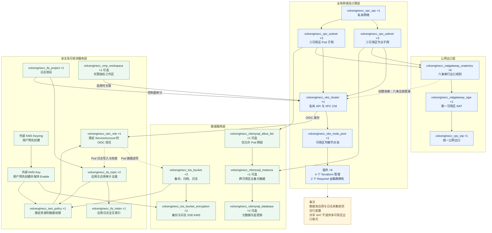

# 企业级分布式数据库自动化管理

使用 Terraform 在火山引擎部署面向分布式数据库的基础设施，包括三可用区 VKE、私有网络、统一公网出口、备份/归档/日志存储、Pod 数据访问身份和 TLS 日志，并可选配 RDS 元数据库与 VMP 监控。KMS Keyring/Key 由用户预先创建并独立管理，数据库软件及备份恢复流程由使用者另行部署。

## 1. 业务背景

企业数据库需要稳定的网络与计算底座、可恢复的备份和可追溯的日志。手工维护这些资源时，常见的问题有：

- **资源关联遗漏**：子网出口、桶加密、数据库白名单和监控关联需要分别配置，遗漏会阻断业务访问。
- **工作负载身份混用**：把部署凭证用于数据库 Pod，会扩大数据访问权限并增加凭证维护成本。
- **变更与回收难核对**：多可用区资源和服务派生资源需要统一管理，避免更新遗漏或销毁残留。

本工程用 Terraform 管理资源依赖，并为 Pod 配置限定 ServiceAccount 的数据访问角色，提供部署、核对和清理步骤。

## 2. 方案概述

节点与 Pod 分别使用三个可用区的私有子网。一个 NAT 和一个 EIP 为六个子网提供统一出口；NAT 位于第一个节点子网，这一出口存在可用区故障风险。单节点池采用 `ZoneBalance`，初始节点至少三个；策略不保证始终每个可用区都有健康节点，部署后必须核对实际分布，数据库副本还需要应用层拓扑分散和反亲和设置。

备份和日志桶为 STANDARD、多可用区、强制 SSE-KMS；归档桶为 ARCHIVE、单可用区，读取前可能需要恢复并产生恢复费用。IAM 角色通过 VKE OIDC 仅信任一个命名空间中的指定 ServiceAccount，TOS 权限限定到三个桶、TLS 权限限定到两个主题。KMS 的 `GenerateDataKey`、`Decrypt` 默认使用账号级 `Resource="*"`；设置 `kms_use_account_wide_resource=false` 后限定为输入的 Key TRN。



实线表示资源引用，虚线表示标注的数据访问、创建依赖或备注。VKE 自动创建的节点 ECS、云盘、网卡、安全组、CNI 组件、IRSA 身份提供商和控制面审计主题由服务管理，随所属集群或节点池核对回收。

## 3. IaC 设计

工程使用 `volcengine/volcenginecc = 0.0.74`，通过六个本地模块组织资源。两个 `local-exec` 脚本分别在创建时协调 Required 插件、在集群删除后清理专用 TLS Project 中的 `vke-audit-*` 派生主题。脚本自动准备 Python 和 SDK，继承执行端的云凭据。

### 3.1 资源清单

| Terraform 资源 | 用途 | 数量 |
|---|---|---:|
| `volcenginecc_vpc_vpc` | 私有 VPC | 1 |
| `volcenginecc_vpc_subnet` | 三个节点、三个 Pod 子网 | 6 |
| `volcenginecc_natgateway_ngw` | 公网 NAT | 1 |
| `volcenginecc_vpc_eip` | 绑定 NAT 的出口地址 | 1 |
| `volcenginecc_natgateway_snatentry` | 每个子网一条 SNAT | 6 |
| `volcenginecc_iam_policy` | TOS/TLS/KMS 数据权限 | 1 |
| `volcenginecc_iam_role` | OIDC 工作负载角色 | 1 |
| `volcenginecc_tos_bucket` | 备份、归档、日志桶 | 3 |
| `volcenginecc_tos_bucket_encryption` | 备份、日志 SSE-KMS | 2 |
| `volcenginecc_tls_project` | TLS 日志项目 | 1 |
| `volcenginecc_tls_topic` | 应用日志、应用审计 | 2 |
| `volcenginecc_tls_index` | 应用主题全文索引 | 1 |
| `volcenginecc_vke_cluster` | VPC CNI、私有 API、IRSA、控制面审计 | 1 |
| `volcenginecc_vke_node_pool` | 按量节点与弹性边界 | 1 |
| `volcenginecc_vke_addon` | Terraform 管理的 prometheus-agent、log-collector、node-problem-detector、csi-ebs | 4 |
| `terraform_data` | Required 插件创建协调 + VKE 派生审计 Topic 销毁清理 | 2 |
| `volcenginecc_vmp_workspace` | 关联 VKE 的托管指标工作区 | 0/1 |
| `volcenginecc_rdsmysql_allow_list` | 绑定实例的 Pod 白名单 | 0/1 |
| `volcenginecc_rdsmysql_instance` | 两个不同可用区的主备实例 | 0/1 |
| `volcenginecc_rdsmysql_database` | 元数据、监控数据库 | 0/2 |

基础配置管理 **34** 个对象，包含 32 个云资源声明和 2 个 `terraform_data` 辅助对象。启用 RDS 增加 4 个对象，启用 VMP 增加 1 个，两者均开启时共 **39** 个。两个 Required 插件 data source、外部 KMS Keyring/Key 和 VKE 服务派生资源不计入受管对象数量；资源声明数量也不等于独立计费项数量。

### 3.2 工程结构

```text
.
├── modules/
│   ├── network/                     # 私网和串行公网出口
│   │   ├── main.tf
│   │   ├── variables.tf
│   │   ├── outputs.tf
│   │   └── versions.tf
│   ├── security/                    # 外部密钥引用与工作负载身份
│   │   ├── main.tf
│   │   ├── variables.tf
│   │   ├── outputs.tf
│   │   └── versions.tf
│   ├── storage/                     # 三个桶与双桶加密
│   │   ├── main.tf
│   │   ├── variables.tf
│   │   ├── outputs.tf
│   │   └── versions.tf
│   ├── observability/               # 日志和可选指标工作区
│   │   ├── main.tf
│   │   ├── variables.tf
│   │   ├── outputs.tf
│   │   └── versions.tf
│   ├── metadata/                    # 可选主备数据库与白名单
│   │   ├── main.tf
│   │   ├── variables.tf
│   │   ├── outputs.tf
│   │   └── versions.tf
│   └── vke/                         # 集群、节点池和插件
│       ├── main.tf
│       ├── variables.tf
│       ├── outputs.tf
│       └── versions.tf
├── examples/
│   └── addon-versions.json.example  # 插件版本配置参考
├── scripts/
│   ├── cloud_api.py                 # 签名 API 辅助函数
│   ├── delete_vke_audit_topics.py    # 派生审计主题清理
│   ├── preflight.py                 # 地域选型预检
│   ├── preflight_kms.py             # 外部密钥预检
│   ├── preflight_runtime.py         # 生命周期运行环境检查
│   ├── reconcile_required_addons.py # 必需插件协调
│   ├── requirements.txt            # 生命周期 SDK 版本
│   └── 运行生命周期.sh             # 自动准备生命周期环境
├── .gitignore
├── main.tf
├── variables.tf
├── outputs.tf
├── providers.tf
├── versions.tf
├── terraform.tfvars                # 使用前替换为自己的参数
├── README.md
└── README.zh-CN.md
```

子模块各自包含 `main.tf`、`variables.tf`、`outputs.tf`、`versions.tf`，Provider 只在根模块配置。

### 3.3 核心代码示例

存储模块接收外部 KMS Key TRN，为备份桶和日志桶配置 SSE-KMS。以下节选自根模块 `main.tf`：

```hcl
module "storage" {
  source        = "./modules/storage"
  name_prefix   = var.name_prefix
  project_name  = var.project_name
  bucket_suffix = var.bucket_suffix
  kms_key_trn   = module.security.kms_key_trn
  tags          = local.tags
}
```

关键依赖包括：六条 SNAT 全部就绪后创建 VKE；节点池就绪后协调 Required 插件并安装其余插件；RDS 实例通过 `allow_list_ids` 绑定仅包含 Pod 网段的白名单。加密关系与绑定关系仍需在部署后独立回读验证。

节点池使用 `ignore_changes = [auto_scaling.desired_replicas]`，只把实时 desired 交给扩缩容控制器，min/max 仍由 Terraform 管理。修改 `node_scaling.desired` 不会调整已有节点池；需要实际改变规模时修改 min/max 或使用独立的运行期扩缩容操作，并验证收敛。

## 4. 使用说明

本工程支持通过 InfraManager 在云上一键部署或下载模板在本地运行。推荐使用云上部署方式，无需自行准备 Terraform 运行环境，只需在平台填写参数即可完成资源创建和托管。

### 4.1 云上部署

InfraManager 是火山引擎提供的 Terraform 托管工作台，更多产品介绍参见 [InfraManager 产品介绍](https://docs.volcengine.com/docs/infrastructure-management/product-introduction?lang=zh)。

#### 4.1.1 准备权限

部署身份需要第 3.1 节资源的创建、查询、更新、删除权限，以及标签管理、EIP 绑定、SNAT 修改、桶加密配置、IAM 策略附加、VKE IRSA/OIDC 管理和 RDS 白名单关联权限。两个插件 data source 需要 VKE 插件读取权限。

生命周期脚本还需要 VKE 的 `ListClusters`、`ListSupportedAddons`、`ListAddons`、`CreateAddon`，以及本栈专用 TLS Project 的 `DescribeTopics`、`DeleteTopic` 权限。工作负载的 TOS/TLS/KMS 数据策略不能替代部署策略。

在 VKE 控制台按引导准备 `VKEObservabilityRole`、`VKECsiRole` 和所需服务关联角色，并完成 TOS SSE-KMS 服务授权。这些共享角色不由模板创建或删除。服务、配额、外部密钥和登录凭据的准备见第 4.2.1 节。

平台执行端须支持 `local-exec`，交付包须包含根模块、六个子模块和完整 `scripts/` 目录。生命周期脚本继承部署身份的 `VOLCENGINE_ACCESS_KEY`、`VOLCENGINE_SECRET_KEY`，临时身份还需 `VOLCENGINE_SESSION_TOKEN`；无需另配 Service AK/SK。执行端的网络与工具要求见第 4.2.1 节。

#### 4.1.2 选择模板

打开 [InfraManager 控制台](https://console.volcengine.com/iac)，进入 **模板管理 > 公开模板**，搜索“企业级分布式数据库自动化管理”。

#### 4.1.3 创建资源栈

选择模板并点击 **创建资源栈**，根据实际需求填写资源栈信息和模板参数。创建并检查执行计划，确认变更符合预期后，点击 **执行部署**。

参数定义及场景见第 4.2.1、4.2.2 节。替换示例参数文件中的账号、密钥、镜像、命名前缀和桶后缀；密码使用平台机密变量，避免同名 `tfvars` 值覆盖注入值。保持默认并发 `10`，确认基础方案为 34 个受管对象，可选资源增量符合第 3.1 节。

#### 4.1.4 部署验证

在资源栈详情页查看部署状态为“成功”，再查看模板输出：

| 输出 | 用途 |
| --- | --- |
| `network` | 定位 VPC、三个节点子网、三个 Pod 子网、NAT、EIP 地址及六条 SNAT |
| `storage` | 三个桶名及外部 KMS Key ID/TRN、密钥环名称 |
| `cluster` | 集群、节点池、六个插件、OIDC 和私有 API 地址 |
| `observability` | TLS 项目、两个主题；VMP 未开启时 `workspace_id=null` |
| `metadata` | 未开启时为 `null`；开启后为 RDS 实例、白名单、私网地址和两个库名 |
| `workload_access` | Pod 接入所需地域、命名空间、ServiceAccount、角色、密钥和日志主题 |
| `expected_managed_resource_count` | 按开关计算的受管对象数量 |

七个输出均未标记为敏感，且不包含密码、AK/SK、Token 或 kubeconfig；其中仍包含资源定位信息，应按项目权限分享。在资源页签核对第 3.1 节对象；基础配置是 32 个云资源和 2 个辅助对象。服务派生资源另在所属服务控制台核对。

按资源栈输出定位资源，在 VKE、TOS、KMS、TLS 控制台完成第 4.2.4 节的基础自检。启用 RDS 或 VMP 时核对对应实例或工作区及关联关系；无需下载本地 Terraform State。

### 4.2 本地部署

您也可以下载本工程模板在本地运行，需要按照下述步骤操作。

#### 4.2.1 环境准备

**基础环境**：

使用 Linux、Terraform `>= 1.5.7, < 2.0.0` 和固定 Provider `volcengine/volcenginecc = 0.0.74`；版本下限同时满足根模块和子模块要求。首次初始化后保留生成的 `.terraform.lock.hcl`。

执行端需要 `/bin/sh`、`curl` 或 `wget`、`unzip` 及 SHA-256 工具，并能访问 Terraform Registry、火山引擎 API、GitHub 和 Python 下载源。`scripts/运行生命周期.sh` 自动准备 Python 3.12 和 `scripts/requirements.txt` 中的依赖，无需手动安装 SDK。

使用 `kubectl` 自检时，执行终端须通过 VPN、对等连接或堡垒机访问私有 Kubernetes API，并从 VKE 控制台取得 kubeconfig。

首次本地部署先从下载的完整模板建立独立运行副本，在该目录保存 State 和运行数据：

```bash
umask 077
mkdir -p /tmp/数据库运行
cp -R modules scripts examples ./*.tf terraform.tfvars /tmp/数据库运行/
cd /tmp/数据库运行
```

在运行副本编辑 `terraform.tfvars`，将已有示例资源标识换成自己的配置，并删除 `node_password`、`metadata_admin_password` 的同名赋值后使用下方环境变量。已有栈的更新和销毁继续使用原 State/backend 与完整工程；生产协作应在首次部署前配置有加密、锁和版本管理的远端 backend。

**服务与配额**：

- 开通第 3.1 节对应服务，准备已有企业项目和第 4.1.1 节权限。核实三个 AZ 的规格、镜像、Kubernetes/插件版本及配额，计算与网络配额按 `node_scaling.max` 预留。
- 预先创建同地域的 KMS 密钥环及对称 Key，状态为 `Enable`、用途为 `ENCRYPT_DECRYPT`，填写匹配的 ID/TRN；桶和备份使用期间保持 Key 可用。
- 密钥登录准备已有 ECS SSH 密钥对，密码登录准备 root 密码；可选 RDS/VMP 另行核实规格、配额和费用。

**凭证注入**（推荐环境变量，不要写入代码或 `tfvars`）：

```bash
export VOLCENGINE_ACCESS_KEY="your_access_key"
export VOLCENGINE_SECRET_KEY="your_secret_key"
export VOLCENGINE_REGION="cn-beijing"
```

临时身份还需注入 `VOLCENGINE_SESSION_TOKEN`。`providers.tf` 显式使用 `var.region`；`VOLCENGINE_REGION` 不会覆盖它，两处应保持一致。

**敏感业务变量**：`node_password` 是密码登录模式的节点 root 密码；`metadata_admin_password` 是启用 RDS 时的高权限账号密码。两者均标记为敏感，建议通过环境变量注入，不要写入 `terraform.tfvars`：

```bash
export TF_VAR_node_password="<node_password>"
# 仅启用 RDS 时设置。
export TF_VAR_metadata_admin_password="<metadata_admin_password>"
```

当前示例文件已有节点密码赋值，先在运行副本删除同名赋值，再使用环境变量。`tfvars` 的同名变量（包括 `null`）优先于 `TF_VAR_*`，对象不会自动合并。后续操作保持相同密码，并保护保存密码的 State 和 Plan 文件。

节点密码为 8–30 位，RDS 密码为 8–32 位，均需满足三类字符及允许字符规则，详见 `modules/vke/main.tf` 和 `variables.tf`。节点密码传入原文，由模块自动 Base64 编码。

**重点参数**：

下表覆盖 `variables.tf` 的全部根输入。“默认值”来自变量定义；未定义默认值的输入标为必填。当前 `terraform.tfvars` 示例使用北京地域、密码登录、`ecs.g3i.xlarge`、Kubernetes `1.32`，关闭 RDS、VMP 和删除保护；`metadata_zones` 显式为北京 a/b。其账号、密钥、镜像、桶后缀和名称不是通用默认值。

| 参数 | 类型；变量默认值 | 说明 |
| --- | --- | --- |
| `region` / `project_name` | string；`cn-beijing` / `default` | 目标地域和已有企业项目 |
| `name_prefix` / `bucket_suffix` | string；`enterprise-db` / 必填 | 3–20 位小写字母、数字或连字符；前缀以字母开头，桶后缀全局唯一且首尾为字母或数字 |
| `account_id` | string；必填 | 部署账号数字 ID |
| `kms_key_id` / `kms_key_trn` | string；必填 | 同地域、同账号的外部 Key UUID/TRN，指向同一密钥 |
| `kms_use_account_wide_resource` | bool；`true` | 账号级 KMS 权限；false 限定为提供的 Key TRN |
| `tags` | map(string)；`{}` | 额外标签，合并到 `ManagedBy`、`Solution` |
| `vpc_cidr` / `service_cidr` | string；`10.80.0.0/16` / `172.30.0.0/16` | 规范 IPv4 网段；VPC 为私网，两者不重叠 |
| `topology` | list(object)；北京 a/b/d 三 AZ | 每项为 `zone`、`node_cidr`、`pod_cidr`；六子网在 VPC 内且互不重叠，完整默认值见 `variables.tf` |
| `nat_spec` / `eip_bandwidth` | string / number；`Small` / `20` | NAT 规格；出口 Mbps，整数 1–200 |
| `image_id` | string；必填 | 以 `image-` 开头的地域镜像，支持所选 VKE 版本 |
| `node_login_mode` | string；`password` | 节点登录，可选 `key_pair`，不影响 kubeconfig |
| `ssh_key_pair_name` / `node_password` | string；`null` / `null` | 按登录方式二选一；密码为敏感变量，传入原始值 |
| `instance_types` / `kubernetes_version` | list(string) / string；`["ecs.g3i.xlarge"]` / `1.32` | 规格须在三 AZ 可用；IRSA 要求版本至少 `1.24` |
| `addon_versions` | object；必填 | 六个插件的地域兼容版本 |
| `required_addons_reconcile_nonce` / `required_addons_timeout` | string / number；`v1` / `1200` | 修改 nonce 重跑必需插件协调；等待秒数，整数 300–3600 |
| `node_scaling` | object；`{min=3, desired=3, max=9}` | 整数，`3 <= min <= desired <= max <= 2000`；desired 仅用于初次创建 |
| `delete_protection_enabled` | bool；`false` | VKE/RDS 删除保护；销毁前更新为 false |
| `workload_namespace` / `workload_service_account` | string；`database` / `data-access` | IAM 信任的命名空间与 ServiceAccount |
| `tls_log_ttl_days` | number；`30` | 应用主题保留天数，整数 1–3650；控制面审计固定 30 天 |
| `enable_vmp` / `vmp_instance_type_id` | bool / string；`false` / `""` | 开启 VMP 时提供可用规格 ID |
| `enable_metadata_db` | bool；`false` | 开启后创建一个主备 RDS 实例、白名单和两个库 |
| `metadata_node_spec` / `metadata_zones` | string / list(string)；`rds.mysql.c.s.1c2g` / `null` | 默认使用拓扑前两个 AZ；两个不同 AZ 均支持所选规格，主 AZ 与第一个节点子网匹配 |
| `metadata_storage_type` / `metadata_storage_gb` | string / number；`CloudESSD_PL0` / `100` | RDS 存储类型与 GB 容量 |
| `metadata_admin_name` / `metadata_admin_password` | string；`db_admin` / `null` | 开启 RDS 时提供管理员密码，密码为敏感变量 |

`addon_versions` 必须提供 `core_dns`、`metrics_server`、`prometheus_agent`、`log_collector`、`node_problem_detector`、`csi_ebs` 六个字段。参照 `terraform.tfvars` 和 `examples/addon-versions.json.example` 填写，换地域或 Kubernetes 版本后重新核实兼容版本。

#### 4.2.2 场景化部署示例

在独立运行目录中初始化与校验：

```bash
terraform init
terraform fmt -check -recursive
terraform validate
```

**案例一：基础底座**。填写必填参数，通过 `TF_VAR_node_password` 注入节点密码，保留以下配置：

```hcl
node_login_mode           = "password"
ssh_key_pair_name         = null
enable_metadata_db        = false
enable_vmp                = false
delete_protection_enabled = false
```

```bash
terraform plan -input=false -out=/tmp/数据库基础.tfplan
# 核对资源、费用及替换动作后执行。
terraform apply -input=false /tmp/数据库基础.tfplan
```

预期管理 34 个对象，包括三 AZ 私网 VKE、共享出口、存储、身份和日志，数据库软件由用户另行部署。

**案例二：启用可选服务**。在基础配置上按下表调整，再使用上述 Plan/Apply 命令审核并部署：

| 场景 | 参数变化 | 预期结果 |
| --- | --- | --- |
| 元数据库 | `enable_metadata_db=true`，核实 `metadata_*` 参数并注入 `TF_VAR_metadata_admin_password` | 新增一个 MySQL 8.0 主备实例、Pod 白名单和两个库，共 38 个对象 |
| 监控 | `enable_vmp=true`，填写可用的 `vmp_instance_type_id` | 新增 VMP 工作区并关联 VKE，共 35 个对象 |
| 两者同时启用 | 提供上述两组参数 | 共 39 个对象 |

节点需要密钥登录时，设置 `node_login_mode="key_pair"`、`ssh_key_pair_name="<ssh_key_pair_name>"`，并删除节点密码赋值、执行 `unset TF_VAR_node_password`，使密码使用默认 `null`。该变化不增加对象数量；已有节点的登录更新按 [VKE 节点池说明](https://docs.volcengine.com/docs/vke/createnodepool?lang=zh) 核实。

关闭 RDS/VMP 开关会删除对应资源，并非暂停服务。修改拓扑、名称或镜像可能触发替换，以计划为准；仅修改 `node_scaling.desired` 不会调整已有节点池。

#### 4.2.3 部署预期结果

基础配置应获得一个私有 API 的 VKE 集群、初始三个按量节点和六个插件。节点池跨三个节点子网，使用 `ZoneBalance`，每节点系统盘 80 GB、`ESSD_PL0`。六个节点/Pod 子网共用一个 NAT/EIP；三个桶、双桶 SSE-KMS、IRSA 数据角色和 TLS 日志资源应建立对应关系。

受管对象数量为 `34 + (enable_metadata_db ? 4 : 0) + (enable_vmp ? 1 : 0)`。两个 Required 插件为只读查询，外部 KMS 和 VKE 派生资源不计入；声明数量不等于计费项数量。

通过以下命令查看输出：

```bash
terraform output
```

七个输出的完整用途见第 4.1.4 节输出表；以 `metadata`、`observability.workspace_id` 判断可选资源是否启用。输出只定位资源，实际状态和业务访问按下一节核对。

#### 4.2.4 部署后验证

根据 `terraform output` 或资源栈输出定位目标，在对应控制台核对：

| 检查项 | 基础预期 |
| --- | --- |
| VPC/NAT | 六个子网均有 SNAT，使用同一 NAT 和 EIP |
| VKE | 集群、节点池和六个插件 Running；节点 Ready，实际分布覆盖三 AZ |
| TOS/KMS | 三桶存在，backup/logs 的 SSE-KMS 指向输入的 Key TRN，密钥状态 Enable |
| IAM | 数据角色信任的命名空间、ServiceAccount 与 `workload_access` 一致 |
| TLS | 两个应用主题及应用主题索引存在，集群开启控制面审计 |
| RDS（开启时） | 一个主备实例、两个库及绑定的 Pod 网段白名单 |
| VMP（开启时） | 工作区存在，VKE 关联对应工作区 |

需要查看 Kubernetes 状态时，从 VKE 控制台取得私有 kubeconfig，在已获授权的终端执行：

```bash
export KUBECONFIG="/tmp/集群私有配置"
kubectl get nodes -L topology.kubernetes.io/zone
kubectl -n "<workload_namespace>" get pods
```

节点查询需要集群级读取权限。异常时先检查云控制台事件、资源关联、配额和网络配置。数据库安装、数据读写及备份恢复由用户结合所选数据库自行测试。

#### 4.2.5 销毁资源

先卸载本栈应用，核对释放其派生的 PVC/云盘、负载均衡器及其他资源。需要保留的备份先迁移并验证恢复。三个 TOS 桶须清空当前对象、历史版本、删除标记和未完成分片，模板不会自动强制清空；恢复中对象或保留策略可能延迟删除。

若 `delete_protection_enabled=true`，先在原参数中改为 false，执行普通 Plan/Apply 更新并在 VKE/RDS 控制台确认保护已关闭。继续使用原 State/backend、相同参数和部署凭证；保存计划及日志均置于工程外。运行标准销毁命令：

```bash
terraform plan -destroy
terraform destroy
```

注意事项：

- 销毁前审核待删除资源；销毁会删除 Terraform 管理的资源。保持默认并发 `10` 和完整 `scripts/` 文件集合。
- 本栈 TLS 项目必须专用，不与其他 VKE 集群共用。销毁先删除本集群，再由 `scripts/delete_vke_audit_topics.py` 清理该项目内所有 `vke-audit-*` 派生主题，最后删除项目。
- 外部 KMS Keyring/Key、共享服务角色和应用自行创建的资源不由主栈删除。销毁桶前不应删除 Key，保留加密备份时持续保留可用 Key。
- 使用 `terraform state list` 确认受管地址已清空，再在各服务控制台核对本栈及服务派生资源。异步删除等待原任务终态后核对，失败时先检查保护、非空桶和资源关联。
- 云上销毁先执行相同清理和关闭保护操作，再在 InfraManager 原资源栈审核销毁计划并执行；通过资源栈状态与服务控制台确认回收。

## 5. 总结

本方案适合需要三 AZ 私网计算、统一出口、加密备份存储和 Pod 数据身份的分布式数据库基础设施：

- 六个模块管理资源依赖，RDS 元数据库和 VMP 按需创建，生命周期脚本协调插件和派生审计主题回收。
- 外部 KMS 独立管理，备份和日志桶强制 SSE-KMS；Pod 使用限定 ServiceAccount 的 OIDC 角色访问数据。
- 单 NAT/EIP 和单 AZ 归档桶有明确容灾边界，节点可用区均衡仍需应用副本分散。KMS 默认账号级权限不满足单 Key 最小权限要求。
- 数据库软件、持久卷、备份恢复和应用可观测规则由使用者配置并验证，模板提供基础设施及可重复的核对入口。

资源字段与接口见 [Provider 官方文档](https://registry.terraform.io/providers/volcengine/volcenginecc/0.0.74/docs)。相关说明：[VKE IRSA](https://docs.volcengine.com/docs/6460/1324613)、[TLS 授权示例](https://www.volcengine.com/docs/6470/812367)。
